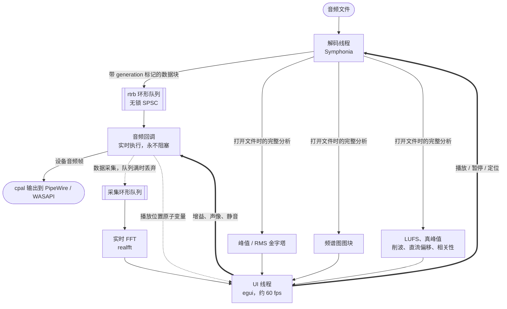

# Auriscope
注意：如有差异，请以英文版为主
### 一款适用于 Linux 和 Windows 的音频播放器与分析工具

*播放一个音频文件，并且* **看见** *它：波形图、频谱图和实时频谱。*

[](LICENSE)
[](https://www.rust-lang.org/)
[](https://github.com/emilk/egui)
[](https://github.com/pdeljanov/Symphonia)
[](#-安装)


**[⬇ 下载最新版本](https://github.com/frdcmp/auriscope/releases/latest)**

Windows `.zip` · Linux `.tar.gz`

---

> Auriscope（耳镜）是医生用来观察耳朵内部的仪器。
>
> 而这个软件，是用来观察音频内部的。

Auriscope 为一个音频文件提供三个同步视图：波形图、整个文件的频谱图，以及实时频谱。其底层是一个播放引擎，它的音频回调函数永远不会阻塞、分配内存或获取锁。

它是一款播放器和分析工具，而不是音频编辑器，因此它永远不会修改你的文件。

---

## 🚀 安装

**Linux**：只需一行命令，无需 root 权限：

```bash
curl -fsSL https://raw.githubusercontent.com/frdcmp/auriscope/main/install.sh | bash
```

**Windows**：在 PowerShell 中执行一行命令，无需管理员权限：

```powershell
irm https://raw.githubusercontent.com/frdcmp/auriscope/main/install.ps1 | iex
```

两个安装脚本都会检查发布包的 SHA-256 校验和，并且只为当前用户安装。

安装位置：

- Linux：`~/.local`
- Windows：`%LOCALAPPDATA%\Programs\Auriscope`

安装过程中还会创建启动器入口、图标和文件关联。

**更新软件时，再次运行相同的命令即可。** 如果已经安装最新版本，脚本不会执行任何操作。

<details>
<summary><b>手动下载、安装脚本参数和文件关联</b></summary>

每次发布都会提供以下两个压缩包：

- `auriscope-<version>-x86_64-windows.zip`
- `auriscope-<version>-x86_64-linux.tar.gz`

每个压缩包旁边都会附带一个 `.sha256` 校验文件。

将压缩包解压到任意位置，然后运行程序即可，无需安装。

Windows 可能会提示发布者未知，因为该二进制文件没有经过代码签名。遇到此提示时，选择：

*更多信息 → 仍要运行（More info → Run anyway）*

应用每天会检查一次是否存在更新版本，因此手动安装的版本也不会成为无法更新的版本。

### 安装脚本参数

| 参数 | 作用 |
| :--- | :--- |
| `--git` | 从 GitHub 获取最新的 `main` 分支，进行构建和安装。仅适用于 Linux。 |
| `--source` | 构建并安装当前运行该脚本所在的工作目录中的代码。仅适用于 Linux。 |
| `--version vX.Y.Z` | 安装指定版本。 |
| `--force` | 即使已经安装了该版本，也强制重新安装。 |
| `--uninstall` | 删除安装脚本安装的所有内容。 |

通过管道执行脚本时，无法直接向脚本传递参数，因此需要先将脚本获取到 Shell 或脚本块中。

例如，Linux：

```bash
curl -fsSL https://raw.githubusercontent.com/frdcmp/auriscope/main/install.sh | bash -s -- --uninstall
```

Windows PowerShell：

```powershell
& ([scriptblock]::Create((irm https://raw.githubusercontent.com/frdcmp/auriscope/main/install.ps1))) -Uninstall
```

### 将 Auriscope 设置为 Linux 某种文件类型的默认打开程序

```bash
xdg-mime default io.github.frdcmp.Auriscope.desktop audio/x-wav
```

WAV 文件对应的 MIME 类型不止一种。如果某个文件仍然被其他程序打开，可以运行以下命令：

```bash
gio info -a standard::content-type yourfile.wav
```

然后也为命令返回的 MIME 类型设置默认程序。

</details>

---

## ✨ 功能特性

| 图标 | 功能 | 说明 |
| :---: | :--- | :--- |
| 🌊 | **波形图（Waveform）** | 使用多分辨率金字塔绘制峰值和 RMS。因此，即使是一个缩小显示的两小时音频文件，也只需要读取几千个缓存值，而不是数百万个采样点。支持按声道显示、dBFS 刻度、以红色标记削波区段，以及放大到单个采样点。 |
| 🔥 | **频谱图（Spectrogram）** | 对整个文件执行 STFT（短时傅里叶变换），分析完成后即可查看。支持窗口大小、重叠率和窗口函数设置；支持线性或对数频率轴；提供九种调色板、对比度曲线，以及可调节的 dB 下限和上限。将鼠标悬停在图像上，可以读取时间、频率、电平和声道信息。 |
| 📈 | **实时频谱（Realtime spectrum）** | 对刚刚输出到音频设备的信号单独执行一次低开销 FFT，并提供平均处理和逐渐衰减的峰值保持轨迹。使用对数坐标轴，与上方频谱图保持一致。 |
| 📊 | **音频交付质量检查（Delivery checks）** | 提供综合响度、短时响度、瞬时响度、响度范围和真峰值（EBU R128）。统计削波采样点数量及削波区段数量。每个声道分别提供采样峰值、真峰值、RMS、直流偏移。还提供立体声相位相关性。 |
| 🎛️ | **完整的播放器（A real player）** | 支持采样级精度的点击定位、拖动选择和循环播放区域、增益与声像控制、每个声道的静音和独奏，以及键盘导航。在 **Levels（电平）** 面板中点击声道名称，可以单独突出显示该声道：将它以全高度绘制，并通过左右两个扬声器播放，就像将该声道单独导入为一个单声道文件一样。无论在哪个视图中，未被监听的声道都会变暗，包括波形图、频谱图以及它自己的电平表。支持双击文件、拖放、`Ctrl+O` 或命令行参数打开文件。Open 按钮旁边的 **Recent（最近文件）** 菜单可以重新打开最近使用的 12 个文件。文件加载完成后会自动开始播放；可以在 **Settings → Playback** 中关闭此功能，或者将自动播放限制为手动打开的文件。 |
| 📸 | **捕获当前视图（Capture what you see）** | 设置按钮旁边的相机按钮可以将波形图、频谱图和频谱保存为 PNG。图片只包含这些视图，不包含周围的工具栏和侧边栏。同时还会在同一目录下生成一个同名 `.json` 文件，其中保存侧边栏显示的全部信息：文件信息、WAVE 文件头、Broadcast Wave 信息、标签、标记点、响度、各声道电平，以及生成图片时所使用的分析参数和时间范围。快捷键：`Ctrl+Shift+S`。 |
| 🤖 | **命令行工具（Command line）** | `auriscope-cli` 可以在没有窗口的情况下执行相同的音频分析。`analyze` 可以为任意文件生成 JSON，也可以递归遍历任意深度的文件夹并行分析；`qc` 可以根据可读取和编辑的规格文件检查音频交付质量；`render` 可以生成带有标注的波形图和频谱图 PNG，并在指定时间范围内绘制时间、频率和分贝坐标轴。适用于脚本、没有显示器的设备，以及需要将音频图片交给能够读取图片的系统的场景。[下文有详细介绍](#-命令行)。 |
| ⚙️ | **统一设置窗口（One settings dialog）** | 按 `Ctrl+,` 打开，所有视图控制选项都集中在这里。可以分别显示或隐藏各个面板，隐藏的面板会将空间让给其他面板。也可以将波形图叠加到频谱图上，形成一个视图条带，并分别调整两者的不透明度。 |
| 🗂️ | **信息丰富的侧边栏（A side panel worth reading）** | 提供文件信息、WAVE 文件头、Broadcast Wave 元数据、标签、提示标记、响度、各声道电平、实时分析参数和光标信息等卡片。播放控制栏最右侧的按钮可以关闭侧边栏，以便为视图腾出更多宽度。如果窗口过窄，无法同时容纳视图和侧边栏，程序会自动关闭侧边栏，直到窗口重新拥有足够空间。 |
| 🔒 | **只读设计（Read-only by design）** | Auriscope 永远不会写入或修改你的音频文件。设置会在不同运行之间持久保存，但音频文件不会发生变化。你打开过的文件列表保存在本机，可以在 Settings → Files 中关闭该功能或清除记录。 |

<details>
<summary><b>缩放时，频谱图如何保持清晰</b></summary>

整个文件的频谱分析使用固定的一个 hop（帧移）进行计算。如果放大到每个像素对应的频谱列数超过一列，图像只会把原有的色块放大，而不会产生更多细节。

因此，缩放时程序会在后台对当前可见范围重新执行变换，并使用适合当前缩放级别的 hop。对于放大的视图，采样采用插值，而不是只选择峰值。

这里有一个需要明确的限制：hop 控制的是变换结果的**采样密度**，而真正的时间分辨率取决于窗口长度。若要区分时间间隔小于一个窗口长度的事件，就需要缩短窗口。

在新的高分辨率图块计算完成期间，程序会继续绘制上一次的高分辨率图块。重新计算会等到视图稳定后再进行，因此滚动鼠标滚轮时，图像不会在不同缩放级别之间突然退回粗糙状态。

渲染在工作线程中执行，并且按照像素列并行处理。在新结果生成之前，旧图像会经过平移和拉伸，以适应新的视图。因此，滚动一次鼠标滚轮只需要消耗一帧，而不必立即重新绘制整个图像。

</details>

<details>
<summary><b>时频重分配（Reassignment），以及为什么频谱线会变细</b></summary>

普通频谱图会将每个频率 bin 的能量绘制在该 bin 的标称频率位置，以及对应帧的标称时间位置。

因此，一个稳定的纯音会在窗口的主瓣范围内扩散，而一个瞬态点击声则会扩散到所有与它重叠的帧中。

**重分配（Reassignment）** 会对每一帧额外执行两次变换，分别使用时间加权窗口和导数窗口。

通过这两次额外变换，可以确定每个 bin 中的能量实际位于什么时间，以及实际对应什么频率，然后将该单元格绘制到相应的位置。

这样，稳定音调会收缩成非常细的线条，而瞬态点击声会收缩成单独的列。

可以在 Settings 中开启此功能。它的代价是：每帧需要执行三次 FFT，而不是一次。

对于比当前帧峰值低 70 dB 以上的单元格，程序仍然按照普通 STFT 的方式放置它们。因为在如此低的能量水平下，估计结果主要受到频谱泄漏影响，定位结果不再可靠。

其他单元格都会以**亚 bin 位置（sub-bin position）**的形式存储，每个单元格额外占用一个字节。

如果将位置四舍五入到整数 bin，滑动的谐波线就会变成阶梯状；如果将它扩散到相邻 bin，又会使线条宽度增加到原来的三倍。

保留小数部分，可以让线条保持一个 bin 的宽度，同时实现平滑移动。

### 调色板（Palettes）

- **Amber（琥珀色）**：较安静的区域使用蓝色，较高能量区域使用橙色。
- **Ember（余烬色）**：保留暖色调，但不使用蓝色，适合叠加在蓝色波形上。
- **Custom（自定义）**：允许用户选择三种颜色，在黑色背景上生成自定义调色板，并提供实时预览条。
- 此外还提供 Magma、Inferno、Viridis、Plasma、Turbo 和 Grey。

波形图和实时频谱也有各自独立的颜色选择器，因此不同视图不必使用相同颜色。

实时频谱的填充区域和峰值保持线会跟随所选曲线颜色变化。

</details>

---

## 🏛️ 架构



整个架构由三条规则决定：

1. **音频回调永远不会阻塞。** 不使用锁、不分配内存、不执行文件 I/O，也不在该线程中记录日志。音频缓冲区欠载会产生可听见的咔嗒声，而一款专门用来寻找咔嗒声的工具绝不能自己产生这种声音。

2. **任何其他线程也不会等待音频回调。** 如果分析数据采集线程跟不上速度，音频回调会直接丢弃需要写入采集队列的数据帧，而不是等待队列腾出空间。

3. **所有定位操作都带有 generation 标记。** 每次定位都会增加一个原子计数器。数据块会携带生成它们时对应的 generation，音频回调会丢弃所有过期数据块。这就是在不使用锁的情况下正确刷新定位状态的方式。

<details>
<summary><b>线程职责、两条分析路径、内存与定位机制</b></summary>

### 解码器（Decoder）

解码器承担两项工作。

打开文件时，它会执行一次完整的后台分析，生成：

- 峰值金字塔。
- 频谱图图块。
- 响度数据。
- 削波统计。
- 直流偏移统计。
- 相位相关性统计。

分析过程中会持续报告进度，因此 UI 可以在结果逐步生成时显示部分分析结果。

播放期间，解码器会提前解码播放位置之后的音频数据，执行重采样和声道映射，然后将带有 generation 标记的数据块推送到环形队列。

### 音频回调（Audio callback）

音频回调会：

- 从环形队列中复制数据。
- 丢弃过期 generation 的数据。
- 应用增益和声像设置。
- 将音频转换为设备所需的格式。
- 通过原子变量发布当前播放位置。
- 将每个缓冲区的数据采集到实时 FFT 通道。

### UI

UI 不拥有任何音频状态。

它只读取原子变量、缓存结果和数据采集环形队列，然后负责绘制界面。

即使 UI 出现卡顿，音频播放也不会受到影响。

### 两条独立的分析路径

整个文件的频谱图采用离线 STFT 进行分析，并缓存为 8 位 dB 列，再通过最大值池化生成更粗糙的层级。

缩小时，只需要选择合适的层级，而不必重新计算。

实时频谱则是对播放数据采集通道执行的一次独立 FFT。

将这两条路径分开，才能让频谱图在打开文件后立即可用。

如果整个文件的频谱图也依赖实时采集通道，那么只有在用户听过某段音频后，这段音频的频谱才会逐渐出现。这对于音频诊断来说毫无用处。

### 内存（Memory）

完整分析过程需要读取每个采样点一次，而定位操作又需要随机访问，因此解码后的 PCM 数据会以 `f32` 格式缓存在 RAM 中。

设计目标是默认将缓存限制在 2 GB，约相当于 48 kHz 双声道音频的 90 分钟数据。

超过该限制后，程序计划改为从磁盘重新解码。

**这一回退机制目前尚未实现。** 参见 [路线图](#-路线图)。

### 定位（Seeking）

定位精度取决于文件格式：

- WAV、AIFF 和 FLAC：支持精确定位。
- MP3 和 AAC：先定位到最近的数据包，再进行解码，并丢弃目标采样点之前的数据，同时考虑编码器延迟和填充。

两种方式最终都能提供采样级精度，但实现成本不同。

</details>

<details>
<summary><b>技术栈，以及选择每个 Crate 的原因</b></summary>

| 领域 | Crate | 选择原因 |
| :--- | :--- | :--- |
| **GUI** | `eframe` / `egui` 0.36 | 即时模式界面（Immediate-mode），适合本身就需要持续重绘的 UI。每个平台都可以生成一个独立的静态二进制文件，不需要 GTK、Qt 或 WebView 依赖链。 |
| **渲染** | 通过 `eframe` 使用 `wgpu` | 频谱图使用 GPU 纹理。Linux 使用 Vulkan，Windows 使用 DX12，但代码相同。 |
| **解码** | `symphonia` 0.6 | 纯 Rust 实现。支持 WAV、AIFF、CAF、FLAC、ALAC、APE、MP3、AAC、OGG/Vorbis 和 Matroska，不需要链接、审计或随程序分发 FFmpeg。 |
| **音频输出** | `cpal` 0.18 | Linux 使用 PipeWire 和 ALSA，Windows 使用 WASAPI，通过同一套 API 实现。 |
| **FFT** | `realfft` 3.5 | 利用实数输入的特性，吞吐量大约可以提高一倍。这对于打开文件时需要对整个文件执行变换的场景非常重要。 |
| **重采样** | `rubato` 5.0 | 高质量异步 sinc 重采样，用于处理采样率与音频设备不一致的文件。 |
| **响度** | `ebur128` | EBU R128 参考实现，与峰值金字塔在同一遍分析过程中运行。 |
| **线程通信** | `rtrb` 0.4 | 提供无锁 SPSC 环形队列，分别用于播放数据队列和分析数据采集通道。 |
| **颜色映射** | `colorous` 加自定义实现 | Amber 和 Ember 是项目自有调色板。Magma、Inferno、Viridis、Plasma 和 Turbo 来自 `colorous`。 |
| **文件对话框** | `rfd` | 在两个平台上提供原生文件打开对话框。 |

### 为什么选择 egui，而不是 Tauri？

如果使用 Tauri，就意味着需要通过 JavaScript Canvas 绘制频谱图，并且每秒 60 次跨越 WebView 边界传输音频帧。

对于一款核心工作就是执行高频率自定义绘图的工具来说，这种边界并不是合适的位置。

### 字体

文本使用随软件打包的 [JetBrains Mono Nerd Font](https://www.nerdfonts.com/)。

其中包括：

- 用于标签的比例字体版本。
- 用于数字对齐的等宽字体版本。
- 用于卡片标题的图标字形。

应用中的所有字号都来自同一套字体比例规范。

</details>

---

## ⌨️ 键盘和鼠标操作

| 按键 | 操作 | 鼠标手势 | 操作 |
| :--- | :--- | :--- | :--- |
| `Space` | 播放 / 暂停 | 单击 | 定位播放位置 |
| `←` `→` | 前进 / 后退 5 秒（按住 `Shift` 时为 1 秒） | 拖动 | 选择区域 |
| `Home` `End` | 跳转到开头 / 结尾 | 滚动 | 以鼠标指针位置为中心缩放 |
| `L` | 循环播放时间标尺上的选定范围 | `Shift` + 滚动 | 平移视图 |
| `F` / `Shift+F` | 缩放到选区 / 适应整个文件 | `Alt+Shift` + 滚动 | 垂直缩放波形 |
| `+` `-` | 放大 / 缩小 | 鼠标中键拖动 | 水平滚动 |
| `Esc` | 先清除高亮，再清除范围 | 右键单击 | 清除高亮和范围 |
| `Ctrl+O` `Ctrl+,` | 打开文件 / 设置 | 拖动分隔线 | 重新分配面板空间（双击恢复默认） |
| `Ctrl+Shift+S` | 将视图保存为 PNG + JSON | | |

选择操作的行为类似于 DAW（数字音频工作站）。

拖动鼠标会突出显示一个区域，同时在时间标尺上设置一个范围。这个范围以带状区域显示，并且两端各有一个控制手柄。

下一次单击会清除高亮区域，但保留时间范围，因此你仍然可以在该范围内定位播放位置。

循环播放时，范围带会变成绿色。

垂直缩放范围为 1x 到 4096x，约相当于 72 dB，足以将噪声底抬升到整个视图的高度。

在 1x 缩放级别下，波形条带恰好对应满量程：0 dBFS 位于顶部边缘，上方没有多余的空白区域。

---

## 🤖 命令行

图形窗口只是使用 Auriscope 的一种方式。

另一种方式是 `auriscope-cli`：它使用相同的解码器、相同的 STFT 和相同的响度分析过程，但不会显示任何窗口。

```bash
# 将侧边栏中的所有信息以 JSON 格式输出到 stdout
auriscope-cli analyze take.wav | jq .loudness

# 并行分析整个目录树，并以表格形式输出
auriscope-cli analyze takes/ --all --csv -o takes.csv

# 根据交付规格进行检查；如果存在失败项则退出码为 1
auriscope-cli qc takes/ --spec specs/mine.toml --render-failures bad/

# 将波形图和频谱图渲染为 PNG，并绘制坐标轴
auriscope-cli render take.wav -o take.png

# 查看疑似编辑点附近的十分之一秒，并使用更短的窗口
auriscope-cli render take.wav --start 3.44 --end 3.62 --window 1024 -o click.png
```

### analyze

`analyze` 输出的内容与截图功能生成的附属 JSON 文件包含相同的数据块，包括：

- 文件信息。
- WAVE 文件头。
- Broadcast Wave 信息。
- 标签。
- 标记点。
- 响度。
- 各声道电平。

因此，无论数据来自截图还是命令行，都可以使用同一个读取器处理。

此外，还可以按需启用四种额外的分析过程：

- `--structure`：结构分析，包括开头、结尾、停顿和呼吸声。
- `--segments`：片段分析。
- `--defects`：缺陷分析，包括数字静音、咔嗒声、编辑接缝和截断。
- `--spectral`：频谱特征分析，包括频谱质心、滚降点、平坦度、编码器频谱上限和嗡嗡声。

目录会被递归遍历到任意深度，并行进行分析。

输出格式可以选择每行一个 JSON 对象，或者每个文件一行的 CSV。

### qc

`qc` 增加了质量判定功能。

TOML 格式的规格文件保存客户约定的各项数值标准。

每条检测结果都包含严重程度以及问题发生的时间。

退出代码可以区分文件检查失败和整个运行过程出现故障这两种情况。

如何编写规格文件，请参阅：

[**docs/QC_SPECS.md**](docs/QC_SPECS.md)

### Claude Code 技能

[`skills/auriscope-cli/`](skills/auriscope-cli/) 是一个 Claude Code 技能。

它可以让驱动该工具的模型了解：

- 工具能够测量哪些指标。
- 什么时候应该相信数值，而不是仅凭图像判断。
- 如何编写质量检查规格文件。

该技能的参考资料会随技能本身一起分发，而不是指向其他人无法访问的本地代码仓库。

当 `~/.claude/skills/` 目录已经存在时，`install.sh` 会将技能安装到该目录中。

可以使用：

- `--skill`：强制安装技能。
- `--no-skill`：禁止安装技能。

Arch 软件包会在 `/usr/share/doc/auriscope/skills/` 下保留一份副本，供用户手动复制。

### render

`render` 会为每个声道绘制一条波形通道和一条频谱图通道。

默认情况下，波形图会**叠加在**频谱图上，形成一个统一的面板，并在旁边绘制振幅对应的分贝刻度。这与应用窗口通常使用的布局完全一致。

- `--no-merge`：将波形图和频谱图拆分显示。
- `--wave-scale db`：将波形包络转换为分贝刻度。

这种转换可以让噪声底以及两个音频片段之间的间隙变得可见。

`--json out.json` 可以在图片旁边生成分析报告，并附加图像的坐标信息：

- 时间范围。
- 频率范围。
- 每个像素所代表的数值。

这样，任何在图像中发现的问题，都可以重新转换成音频文件中的具体位置。

### 为什么坐标轴很重要

一张没有坐标轴的频谱图，只能显示某件事情发生了，却无法说明它发生在什么时候、什么频率。

对于无法直接点击图像的使用者来说，这毫无用处。

例如：

- 几周后重新查看一份记录。
- 批量分析报告。
- 让一个模型判断音频文件出了什么问题。

这些场景都需要明确的坐标信息。

完整的命令行参考文档请参阅：

[**docs/CLI.md**](docs/CLI.md)

其中包含所有选项、JSON 数据结构、退出代码，以及如何让输出结果保持可信的使用建议，包括：

- 优先关注数值。
- 如何选择窗口大小。
- 编辑接缝、编码器频谱上限和数字静音间隙实际上是什么样子。

<details>
<summary><b>命令行选项（Options）</b></summary>

### render 相关选项

| 选项 | 说明 |
| :--- | :--- |
| `--start` `--end` | 时间范围，单位为秒。只分析可见范围，因此即使是很长的文件，也能快速生成局部放大图。 |
| `--width` `--height` `--wave-height` | 图像像素尺寸。高度按每条通道分别计算；`--wave-height 0` 或 `--no-waveform` 可以隐藏波形图。 |
| `--channel N` | 只绘制指定声道，声道编号从 0 开始。默认绘制全部声道，并依次堆叠。 |
| `--window` `--overlap` `--window-fn` `--reassign` | STFT 参数，与设置窗口中的选项一致。重叠率可以使用 `75`、`75%` 或 `3/4` 表示。 |
| `--db MIN:MAX` `--contrast` `--colormap` | 颜色映射参数，与设置窗口中的选项一致。 |
| `--min-hz` `--max-hz` `--log` | 频率坐标轴。默认使用线性坐标；`--log` 使用从 20 Hz 开始的对数坐标。 |
| `--no-merge` `--merge-opacity` `--wave-scale` `--wave-zoom` | 波形显示方式：独立通道或叠加在频谱图上；线性或 dB 刻度，以及窗口中的垂直缩放级别。 |
| `--spectrum` | 在时间轴视图下方添加一个频率对应电平的频谱面板，显示整个时间范围。 |
| `--no-axes` | 只输出纯频谱图，不添加边距和标签，适合交给其他程序处理。 |
| `--quiet` | 不在 stderr 中输出进度信息。错误仍然会输出到 stderr；JSON 始终只输出到 stdout。 |

### analyze 和 qc 相关选项

| 选项 | 说明 |
| :--- | :--- |
| `--structure` `--segments` `--defects` `--spectral` `--all` | 启用默认情况下关闭的额外分析过程。 |
| `--timeline` | 按时间输出响度和电平，每 100 ms 生成一条记录。 |
| `--csv` `--jobs N` | 使用扁平表格代替 JSON Lines，并指定同时处理的文件数量。 |
| `--spec PATH` `--fail-only` `--render-failures DIR` | 仅用于 `qc`：指定规格文件、只显示失败项目，以及为每个失败项目生成图片。 |

放大视图时，程序会重新对可见范围执行变换，使每个分析列对应一个像素列。

这与图形窗口使用的方式相同，因此短时间范围也能获得窗口长度所允许的最高图像清晰度。

</details>

---

## 🗺️ 路线图（Roadmap）

尚待完成的工作：

| 图标 | 待办事项 |
| :---: | :--- |
| 🧠 | **大文件支持。** 超过 PCM 缓存上限后的流式处理回退机制尚未实现，因此目前每个文件都会被完整解码并载入 RAM。 |
| 🎮 | **在 GPU 上生成频谱图。** 当前程序会将频谱图上传为 GPU 纹理，但对数频率映射和重采样仍然在 CPU 上完成，生成的是视口尺寸的图像。最终计划使用 Shader 实现这些工作。 |
| 🧵 | **实时频谱线程。** 实时 FFT 目前运行在 UI 线程中。每帧执行一次 4096 点实数 FFT 尚未造成问题；如果将来出现性能问题，再将其移出 UI 线程。 |
| 🪟 | **Windows。** 项目已经能够在 CI 中成功编译，但目前还没有人在 Windows 上实际听过它。此外，程序仍然需要为 `.exe` 添加图标资源、为双击打开添加文件关联，以及添加 winget 清单。 |
| 📦 | **软件分发。** AUR 软件包已经编写完成，但尚未正式发布。 |
| 🔖 | **A/B 标记点。** 支持放置两个标记，并在它们之间快速跳转。 |

---

## 🔨 从源码构建（Building from source）

你需要安装 Stable Rust 工具链，项目通过 `rust-toolchain.toml` 固定了所需的具体版本。

Linux 需要安装 ALSA 开发头文件和用于文件对话框的 GTK 3。

Windows 不需要额外依赖。

### Linux 依赖安装

Arch Linux：

```bash
sudo pacman -S alsa-lib gtk3
```

Debian / Ubuntu：

```bash
sudo apt install libasound2-dev libgtk-3-dev
```

### 运行程序

```bash
cargo run -- path/to/file.flac
```

Debug 构建已经具有实际使用价值，因为 `Cargo.toml` 将依赖项的优化级别设置为 `opt-level = 3`，同时保留你自己代码的 Debug 配置。

如果需要进行性能基准测试，或者准备发布软件，请使用 `--release`。

需要注意，Release 配置可能需要几分钟，因为它使用了 Fat LTO（全程序链接时优化），并且只使用一个代码生成单元。

### 开发时的快速构建与运行循环

为了方便修改代码后立即查看效果，项目提供了 [`dev.sh`](dev.sh)。

每次保存文件时，它都会自动重新构建并重启程序。

修改 UI 时，整个过程大约需要 1.5 秒。

```bash
./dev.sh                 # 重新打开上次使用的文件
./dev.sh path/to/file.wav
```

Rust 没有实用的热重载机制，因此该脚本会重新启动进程。

不过，这个过程开销很小：设置和上次打开的文件都会被保存，所以应用会恢复到相同的文件、调色板和缩放级别。

如果构建失败，脚本不会关闭当前正在运行的窗口。这样你可以继续查看上一个成功运行的版本，同时修复错误。

如果安装了 `inotify-tools`，脚本会使用 `inotifywait` 监视文件变化；否则就使用轮询方式。

因此，它不要求额外安装任何工具。

`cargo watch -x run` 也可以完成类似的工作。

<details>
<summary><b>运行最新的 main 分支、开发版本标记以及 Arch 软件包构建</b></summary>

### 安装最新开发版本

```bash
curl -fsSL .../install.sh | bash -s -- --git    # 克隆 main，构建并安装
./install.sh --source                           # 构建当前工作树中的代码
cd packaging/arch/auriscope-git && makepkg -si  # Arch 对应方式，由 pacman 管理
```

`--git` 会将源码克隆到：

```text
~/.cache/auriscope-src
```

后续运行时会复用该目录，并将其重置为最新状态。

每次都会获取最新的提交。

开发版本会通过 `git describe` 标记出来。该标记会显示在 `--version` 命令的输出以及 About 信息卡片中。

例如：

```console
$ auriscope --version

0.1.1                              # 正式发布版本
0.1.1 (dev v0.1.1-7-g1a2b3c4)     # 比 v0.1.1 多出七次提交的开发版本
```

如果在开发版本上安装正式发布版本，安装程序始终会继续安装，而不会提示“已经是最新版本”。

这就是恢复到经过测试的正式版本的方法。

</details>

---

## 🧪 测试（Testing）

项目没有提交任何音频测试文件。

测试会自行合成所需的信号，包括：

- 一个正弦波：对于每一种窗口函数，都必须落在预期的 FFT bin 中，并具有预期的幅度。
- 在峰值金字塔的每个层级中检查最小值、最大值和 RMS。
- 一个 WAV 文件：经过 Symphonia 编码和解码往返处理后，采样点必须完全一致。
- 一个 R128 参考音调：测量结果必须在允许误差范围内达到 −23.0 LUFS。
- 一个从 44.1 kHz 转换到 48 kHz 的音频：转换后必须保留原始音调频率和峰值电平。

这些测试要求将分析代码放入一个测试可以直接调用的库 Crate 中，而这也正是保持 UI 层精简的原因。

### 运行测试

```bash
cargo test
cargo clippy --all-targets -- -D warnings
```

<details>
<summary><b>开发工具：播放测试工具、截图和频谱图性能基准测试</b></summary>

### 播放测试工具

```bash
# 通过真实音频设备播放 3 秒，
# 在播放到 1.5 秒时执行定位，并报告播放位置进度、
# 数据采集吞吐量以及缓冲区欠载次数。
# 不会打开图形窗口。
cargo run --example play -- file.wav 3 1.5
```

### 截图工具

```bash
# 捕获整个窗口的一帧并退出；
# 如果路径使用 .ppm 后缀，则输出原始 PPM 格式。
# 项目 README 中的截图就是通过这种方式生成的。
AURISCOPE_SCREENSHOT=shot.png cargo run -- file.wav
```

截图还支持以下变体：

- `AURISCOPE_SCREENSHOT_ZOOM=1.00,1.06`：指定时间范围，测试细节图块处理路径。
- `AURISCOPE_SCREENSHOT_SETTINGS=1`：启动时打开设置对话框。
- `AURISCOPE_SCREENSHOT_SETTINGS=end`：将设置对话框滚动到最后一张卡片。
- `AURISCOPE_SCREENSHOT_RANGE=0.4,0.9`：在时间标尺上设置一个循环播放范围。

### 频谱图性能基准测试

```bash
# 在四种缩放级别下，分别测试整个文件的 STFT、
# 细节图块和视口渲染的耗时，并比较是否启用重分配。
cargo run --release --example bench_spec -- file.wav 2048 4

AURISCOPE_THREADS=1 cargo run --release --example bench_spec -- file.wav
```

`AURISCOPE_THREADS` 用于限制整个应用中负责图块分析和渲染的工作线程数量。

该测试工具还会逐单元格比较并行图块和单线程图块，确保两者结果完全一致。

</details>

---

## 📦 软件打包（Packaging）

发行版所需的全部内容都在仓库中：

- `assets/`：桌面入口文件和 AppStream 元数据。
- `packaging/`：各种软件包的构建配置。

所有软件包都从版本标签构建，因此**必须先创建标签（Tag first）**：

```bash
git tag v0.1.0 && git push --tags
```

随后，发布工作流会自动附加 Linux 和 Windows 压缩包。

完整的分步骤发布说明请参阅：

[RELEASING.md](RELEASING.md)

<details>
<summary><b>更新检查、Arch 和 Windows 特定说明</b></summary>

### 更新检查（Update check）

使用 `update-check` 功能构建的软件，在启动时会检查是否存在新版本。

该功能默认启用，并且包含在正式发布的压缩包中。

程序会向 `api.github.com` 查询最新版本，最多每天检查一次，并在播放控制栏中显示一个小型通知按钮，例如：

*"0.2.0 available"（0.2.0 版本可用）*

程序不会下载任何内容，也不会发送有关本机的信息，除了普通的 HTTPS 请求之外。

你可以在 Settings → About 中关闭更新检查，也可以跳过某个版本。

发行版软件包会将该功能排除在外（使用 `--no-default-features`），因为软件包管理器本身就是它们的更新渠道。

### Arch Linux

`packaging/arch/auriscope/PKGBUILD` 用于构建带版本标签的正式发布版本。

`packaging/arch/auriscope-git/PKGBUILD` 用于构建 `main` 分支，不需要正式发布，也不需要 AUR 账户。

发布到 AUR 的步骤：

```bash
updpkgsums
makepkg --printsrcinfo > .SRCINFO
```

然后推送到：

```text
ssh://aur@aur.archlinux.org/auriscope.git
```

### Windows

`#![windows_subsystem = "windows"]` 用于隐藏控制台窗口。

发布工作流会生成 ZIP 压缩包。

窗口图标和任务栏图标会在运行时设置。

目前仍然缺少：

- `.exe` 文件中的图标资源。
- 双击打开文件所需的文件关联。
- winget 清单。

</details>

---

## ⚖️ 许可证（Licence）

**GPL-3.0-or-later。**

任何人都可以使用本软件。

任何人如果修改了本软件并将其分发，就必须按照相同的许可条款公开自己的修改内容。

详情请参阅 [LICENSE](LICENSE)。

随软件一起分发的 JetBrains Mono Nerd Font（`assets/fonts/`）版权归 JetBrains Mono Project Authors 所有，采用 SIL Open Font License 1.1 许可证，具体内容见 `assets/fonts/OFL.txt`。

Nerd Fonts 的字形补丁采用 MIT 许可证。

### 尚未确定的事项（Open decisions）

- **PCM 缓存上限。** 默认 2 GB 的缓存上限以及超过上限后的流式处理回退机制尚未实现。
- **插件托管。** 是否将来支持加载 CLAP 或 VST3 分析插件。目前倾向于不支持，因为这与“播放器，而不是编辑器”的设计定位相冲突。
- **Symphonia 支持范围之外的格式。** 如果要支持 Opus 和 WavPack，需要引入额外的 Crate。